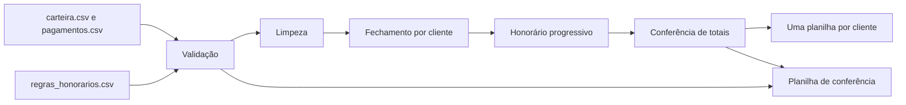

# 💰 Fechamento de Recuperação de Crédito com pandas

Automação em **Python (pandas)** do fechamento mensal de valores recuperados e honorários, com **prestação de contas em planilhas Excel** para cada cliente e uma planilha de **conferência** que aponta os problemas encontrados nos dados.

> Os dados do projeto são **fictícios** e gerados por script. Nenhuma informação real de pessoas ou empresas é usada.


## 🎯 Problema de negócio

Em uma operação de recuperação de crédito, todo mês é preciso:

1. consolidar os pagamentos recebidos dos devedores;
2. descartar registros com problema (duplicidade, valor inválido, devedor inexistente);
3. calcular, por cliente, o **valor recuperado** e os **honorários** devidos;
4. entregar a **prestação de contas** a cada cliente e o fechamento ao financeiro.

Feito à mão em planilhas, o processo é lento e sujeito a erro. Este projeto automatiza todas as etapas e deixa um **rastro de conferência** (totais de controle e lista de erros).

## 🔄 Fluxo



## 📏 Regra de honorários

Os percentuais ficam em `config/regras_honorarios.csv`, **por cliente**, e não no código. O cálculo é **progressivo**: cada percentual incide apenas sobre a parte do valor que cai dentro da sua faixa.

| id_cliente | faixa_min | faixa_max | percentual |
|---|---|---|---|
| BancoA | 0 | 50.000 | 20% |
| BancoA | 50.000 | 200.000 | 15% |
| BancoA | 200.000 | *(sem limite)* | 10% |
| VarejoB | 0 | 100.000 | 18% |
| VarejoB | 100.000 | *(sem limite)* | 12% |
| TelecomC | 0 | *(sem limite)* | 15% |

**Exemplo (BancoA, recuperado de 190.959,59):** 50.000 × 20% + 140.959,59 × 15% = **31.143,94** de honorários.

## ✅ Validações

A etapa de validação não apaga nada em silêncio: cada problema vai para a aba **Erros** da planilha de conferência, com o motivo.

| Erro detectado | Tratamento na limpeza |
|---|---|
| Pagamento duplicado (mesmo `id_pagamento`) | Mantém a primeira ocorrência |
| Valor nulo, zero ou negativo | Descartado |
| Devedor inexistente na carteira | Descartado |
| Pagamento anterior à entrada da dívida | Descartado |
| Cliente sem regra de honorário cadastrada | Descartado, para não fechar com percentual errado |

Depois do cálculo, o programa confere que **a soma dos clientes é igual ao total da base** e que **honorário + repasse = recuperado**. Se não bater, a execução para com erro.

## 📁 Estrutura

```
fechamento-recuperacao-pandas/
├── README.md
├── requirements.txt
├── pytest.ini
├── config/
│   └── regras_honorarios.csv      # faixas e percentuais por cliente
├── data/                          # CSVs gerados (não versionados)
├── src/
│   ├── gerar_dados.py             # gera dados fictícios com erros plantados
│   └── fechamento.py              # validação, cálculo e exportação
├── tests/
│   └── test_fechamento.py         # testes das regras de negócio
└── saida/                         # planilhas geradas (não versionadas)
```

## 🚀 Como executar

```bash
# 1. Ambiente
python -m venv .venv
source .venv/bin/activate          # Windows: .venv\Scripts\activate
pip install -r requirements.txt

# 2. Gerar os dados fictícios (carteira.csv e pagamentos.csv)
python -m src.gerar_dados --seed 42

# 3. Rodar o fechamento de um mês
python -m src.fechamento --mes 2026-10

# 4. Rodar os testes
python -m pytest
```

Sem `--mes`, o programa usa o último mês com pagamentos válidos. Outros parâmetros: `--dados`, `--regras` e `--saida`.

## 📤 Saídas

| Arquivo | Conteúdo |
|---|---|
| `prestacao_<cliente>_<mês>.xlsx` | Aba **Resumo** (recuperado, honorário, repasse, taxa de recuperação) e aba **Detalhe** (um pagamento por linha, com total em fórmula do Excel) |
| `conferencia_<mês>.xlsx` | Aba **Fechamento** (todos os clientes), **Controle** (totais de controle) e **Erros** (linhas com problema e o motivo) |

**Exemplo de resultado** (dados fictícios, `seed=42`, mês 2026-10):

| Cliente | Recuperado | Honorário | Repasse ao cliente | % efetivo | Taxa de recuperação |
|---|---|---|---|---|---|
| BancoA | 190.959,59 | 31.143,94 | 159.815,65 | 16,3% | 12,1% |
| TelecomC | 135.092,86 | 20.263,93 | 114.828,93 | 15,0% | 14,0% |
| VarejoB | 154.067,37 | 24.488,08 | 129.579,29 | 15,9% | 11,3% |

Nesse exemplo, o programa leu 901 pagamentos, apontou **9 linhas com problema** e fechou 308 pagamentos válidos no mês, num total de **480.119,82** recuperados e **75.895,95** de honorários.

## 🧪 Testes

Os testes (`pytest`) cobrem o cálculo progressivo em uma, duas e três faixas, o percentual único sem limite superior, a detecção de cada tipo de erro, a limpeza dos registros inválidos e o alerta quando o fechamento não bate com a base.

## 🧠 Decisões de projeto

- **Regras fora do código:** mudar um percentual ou criar uma faixa não exige alterar o Python.
- **Funções pequenas e testáveis:** cada etapa do fluxo é uma função separada.
- **Falhar de forma visível:** erros de dados viram relatório, e divergência de totais interrompe a execução.
- **Dados reproduzíveis:** o gerador usa `seed`, então qualquer pessoa obtém os mesmos números.

## 🔭 Próximos passos

- Ler os pagamentos direto de um banco MySQL (`pandas.read_sql` com SQLAlchemy).
- Enviar as planilhas por e-mail de forma automática.
- Agendar a execução mensal.
- Conectar a pasta `saida` a um dashboard no Power BI.

## 👤 Autor

**Felipe Luna**

📧 [LinkedIn](https://www.linkedin.com/in/felipe-luna-581377152/)
💻 [GitHub](https://github.com/Flip-data96)
